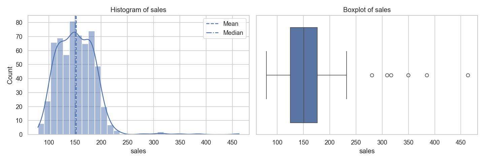
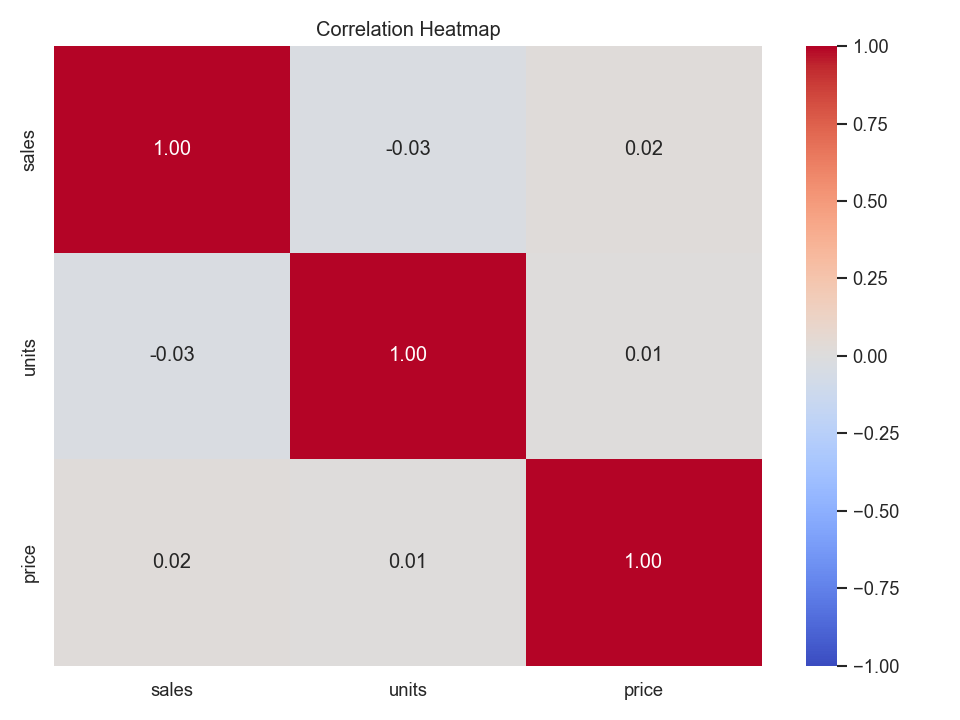
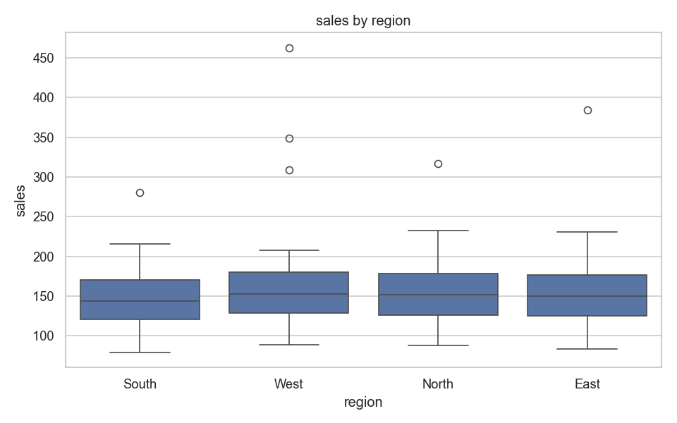
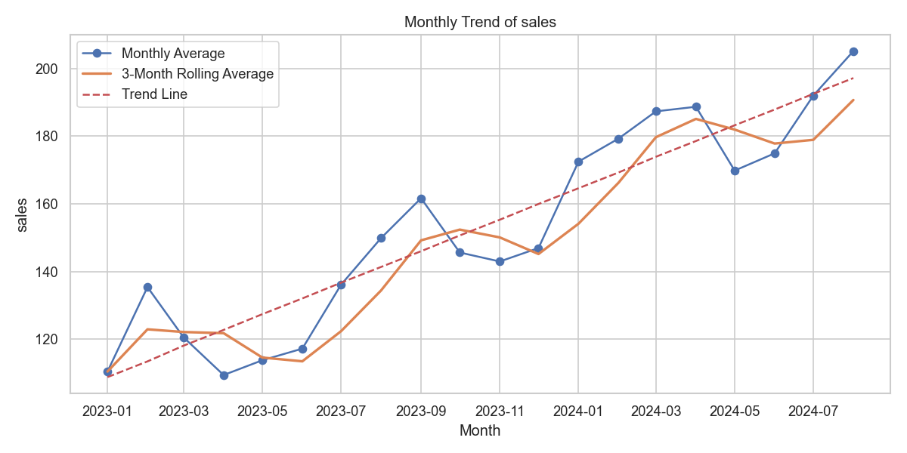

# Data Analytics Practical Portfolio

A curated collection of six Python Data Analytics practicals demonstrating end-to-end data manipulation, relational dataset merging, data cleaning, statistical exploratory data analysis (EDA), and interactive web dashboards.

---

## 📌 Repository Overview

This repository showcases foundational and advanced data analysis competencies built using industry-standard Python libraries. Each practical addresses a core dimension of the modern data analyst skillset:

| # | Practical Name | Directory | Key Topics & Operations | Primary Libraries |
|---|----------------|-----------|-------------------------|-------------------|
| **01** | **Pandas Fundamentals & Statistics** | [`01-pandas-basics/`](01-pandas-basics/) | DataFrame creation, conditional filtering (subsetting), sorting (ascending/descending), groupby aggregations, central tendency metrics (mean, median, mode). | `pandas` |
| **02** | **Control Flow & Custom Functions** | [`02-control-flow-functions/`](02-control-flow-functions/) | Interactive CLI data intake, reusable evaluation functions, grading logic (Distinction/Pass/Fail), `.apply()` Series mapping, iterative processing. | `pandas` |
| **03** | **Dataset Merging & Integration** | [`03-dataset-merging-joining/`](03-dataset-merging-joining/) | Vertical & horizontal concatenation (`pd.concat`), relational database merges (inner, left, right, outer), index-based joins (`join`), multi-key matching. | `pandas` |
| **04** | **Data Cleaning & Transformation** | [`04-data-cleaning-transformation/`](04-data-cleaning-transformation/) | Explicit type conversion (`astype`), text standardization (`str.strip()`, `str.title()`), datetime parsing, temporal feature engineering (Year, Month, Day). | `pandas` |
| **05** | **Exploratory Data Analysis (EDA)** | [`05-eda-and-visualization/`](05-eda-and-visualization/) | Missing value diagnostics, skewness & variance analysis, IQR-based outlier detection, distribution plots, correlation heatmaps, time-series regression. | `pandas`, `numpy`, `matplotlib`, `seaborn` |
| **06** | **Interactive Sales Dashboard** | [`06-interactive-sales-dashboard/`](06-interactive-sales-dashboard/) | Production-style web analytics app, dynamic reactive KPI scorecards, multi-attribute filter controls (Region, Category, Date range), Plotly figures. | `dash`, `plotly`, `pandas`, `numpy` |

---

## 📂 Project Structure

```text
Data-Analytics-Portfolio/
│
├── README.md                               <-- Portfolio documentation & project overview
├── requirements.txt                        <-- Project dependencies
├── .gitignore                              <-- Build, IDE, and temporary file exclusions
│
├── 01-pandas-basics/
│   └── practical_1_pandas_basics.py        <-- Subsetting, sorting, groupby & statistics
│
├── 02-control-flow-functions/
│   └── practical_2_control_flow.py         <-- Loops, functions, and student performance analysis
│
├── 03-dataset-merging-joining/
│   └── practical_3_merging_joining.py      <-- Concatenation, inner/outer merges & joins
│
├── 04-data-cleaning-transformation/
│   └── practical_4_data_transformation.py  <-- Type casting, string cleaning & datetime extraction
│
├── 05-eda-and-visualization/
│   ├── practical_5_eda_visualization.py    <-- Full statistical EDA pipeline
│   └── outputs/                            <-- Visual outputs generated from EDA
│       ├── step5_distribution.png
│       ├── step7_correlation.png
│       ├── step8_groups.png
│       └── step9_trend.png
│
└── 06-interactive-sales-dashboard/
    └── practical_6_sales_dashboard.py      <-- Interactive Plotly Dash web dashboard
```

---

## 📊 Exploratory Data Analysis Showcase (Practical 5)

Practical 5 executes a complete statistical inspection pipeline on business metrics. Below are key visual outputs produced by the analysis:

### 1. Target Distribution Analysis
Visualizes data spread using dual representations: a Kernel Density Estimation (KDE) histogram comparing mean and median, alongside a distribution boxplot.


---

### 2. Feature Correlation Heatmap
Computes pairwise Pearson correlation coefficients to discover relationships among numerical attributes.


---

### 3. Categorical Subgroup Comparison
Compares target distributions across operational regions using quartile boxplots.


---

### 4. Time-Series Trend & Moving Average
Models monthly sales over time, integrating a 3-month rolling average and an ordinary least squares (OLS) regression trendline with calculated $R^2$ fit.


---

## 🚀 Setup & Execution Guide

Follow these steps to run any practical on your machine:

### 1. Clone or Open the Repository
```bash
git clone https://github.com/<your-username>/Data-Analytics-Portfolio.git
cd Data-Analytics-Portfolio
```

### 2. Create and Activate a Virtual Environment
- **Windows (Command Prompt / PowerShell):**
  ```powershell
  python -m venv venv
  .\venv\Scripts\activate
  ```
- **macOS / Linux:**
  ```bash
  python3 -m venv venv
  source venv/bin/activate
  ```

### 3. Install Dependencies
```bash
pip install -r requirements.txt
```

### 4. Run the Practicals

- **Practical 1 (Pandas Basics):**
  ```bash
  python 01-pandas-basics/practical_1_pandas_basics.py
  ```

- **Practical 2 (Control Flow & Functions):**
  ```bash
  python 02-control-flow-functions/practical_2_control_flow.py
  ```

- **Practical 3 (Dataset Merging):**
  ```bash
  python 03-dataset-merging-joining/practical_3_merging_joining.py
  ```

- **Practical 4 (Data Cleaning & Transformation):**
  ```bash
  python 04-data-cleaning-transformation/practical_4_data_transformation.py
  ```

- **Practical 5 (EDA & Visualizations):**
  ```bash
  python 05-eda-and-visualization/practical_5_eda_visualization.py
  ```

- **Practical 6 (Interactive Dashboard):**
  ```bash
  python 06-interactive-sales-dashboard/practical_6_sales_dashboard.py
  ```
  *After running Practical 6, open your web browser and navigate to `http://127.0.0.1:8050` to interact with the dashboard.*

---

## 🛠️ Tech Stack & Skills Summary

- **Programming:** Python 3.x
- **Data Wrangling:** Pandas, NumPy
- **Data Visualization:** Matplotlib, Seaborn, Plotly Express
- **Interactive Dashboards:** Dash (Plotly)
- **Key Competencies:**
  - Relational Data Modeling (SQL-style Joins & Merges)
  - Statistical Hypothesis Exploration & Outlier Diagnostics (IQR rule)
  - String Sanitization & Date Feature Engineering
  - Interactive Web-based Business KPI Reporting
